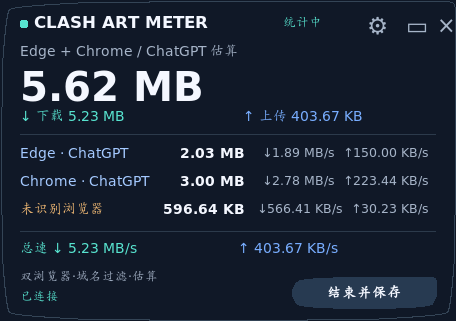

# Clash Art Meter · Edge + Chrome 双浏览器版

Windows desktop floating widget for monitoring **estimated ChatGPT/OpenAI traffic through Clash for Windows / Mihomo**, with Edge, Chrome and unattributed traffic displayed separately.

Windows 桌面悬浮窗：只统计经过 Clash 且匹配 ChatGPT/OpenAI 域名的可观测流量，并尽量区分 Edge、Chrome 和未识别浏览器的连接。



## 下载 Windows EXE（不需要安装 Python）

1. 打开 [GitHub Actions → Build Windows EXE](../../actions/workflows/windows-build.yml)。
2. 选择最近一次绿色勾选、状态为 **Success** 的运行记录。
3. 在 **Artifacts** 下载 **ClashArtMeter-DualBrowser-Windows-x64**。
4. 解压得到 `ClashArtMeterDual.exe`，双击运行。

> GitHub Actions 的产物与正式 Release 不同：Artifacts 需要登录 GitHub，且可能过期。如果没有成功的构建，先到 Actions 查看测试/打包报错。

## 直接使用源码

1. 点击仓库首页 **Code → Download ZIP**，解压仓库。
2. 进入 `ClashArtMeter_DualBrowser` 文件夹。
3. 安装 Python 3.11 或更高版本，然后双击 `start_windows.bat`。
4. 点击悬浮窗的设置按钮，填入本机 Clash 控制器地址（例如 `http://127.0.0.1:61311`，仅作示例）与对应 **API Secret**。
5. 选择 **Edge + Chrome 的 ChatGPT** 模式，点击保存并连接；作图前开始计时，作图完成后结束并保存。

详细中文操作步骤参见 [项目说明](ClashArtMeter_DualBrowser/README.md)。

## 功能

- 按域名过滤，默认包含 `chatgpt.com`、`openai.com`、`oaiusercontent.com`、`oaistatic.com`。
- 尽可能按浏览器进程归属区分 Edge 和 Chrome；无法识别的流量单独归类。
- 浮窗展示上传/下载速率、本次会话总量和历史记录。
- 历史保存在本地 SQLite 数据库；只读访问本机 Clash/Mihomo 控制器。

## 计量限制

**这是近似统计工具，不是精确的图像生成计费/套餐流量工具。**

- ChatGPT 普通聊天和作图若使用相同域名，无法分辨，只能按开始/结束会话时间估计。
- 极短连接、直连、IP-only 连接、未覆盖的 CDN 域名可能遗漏。
- Clash 流量字节数不等于机场计费流量（倍率、封装开销可能不同）。
- 部分 Clash for Windows 版本不提供进程身份信息，因此 Edge/Chrome 的单独归属可能不完整。

## 隐私

仓库不包含本机 API Secret、会话数据库或浏览器个人数据。应用在本机 `%LOCALAPPDATA%\ClashArtMeter\` 保存配置（其中 Secret 为明文）与历史数据。不要上传该目录或向他人分享 Secret。程序不访问聊天正文、浏览器 Cookie、密码或生成图片内容。

## 开发和打包

```powershell
cd ClashArtMeter_DualBrowser
py -m unittest discover -s tests -v
py app.py
```

在 Windows 上可执行 `scripts\build_windows.bat`。仓库中的 [GitHub Actions workflow](.github/workflows/windows-build.yml) 会在推送源码变更时自动测试并打包。

MIT License.
